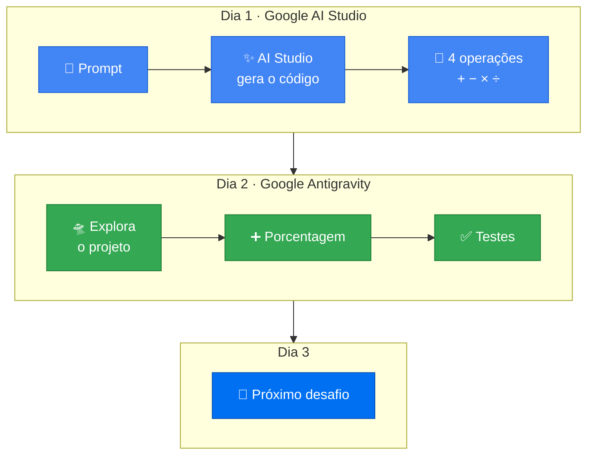

<div align="center">


**[🎯 Desafios](#-trilha-de-desafios) · [🔄 Jornada](#-a-jornada-do-código) · [🖥️ Demonstração](#%EF%B8%8F-demonstração) · [🛠️ Como rodar](#%EF%B8%8F-pré-requisitos-e-execução)**

</div>

---

## 📖 Sobre

Repositório dedicado ao acompanhamento prático dos desafios da **Imersão IA da Alura**, explorando as ferramentas do ecossistema do Google: **Google AI Studio** e **Google Antigravity**.

O projeto central é uma aplicação de calculadora em Python, desenvolvida iterativamente com o auxílio de inteligência artificial: gerada no AI Studio e evoluída/refatorada via Antigravity.

> [!NOTE]
> O código é escrito pelas IAs. O que é meu está em [`anotacoes/`](anotacoes/): os prompts usados, as perguntas respondidas e o que aprendi em cada etapa.

---

## 🔄 A jornada do código



---

## 🎯 Trilha de Desafios

| Dia | Tema | Ferramenta | Anotações | Status |
|:---:|:---|:---:|:---:|:---:|
| **1** | Criando sua primeira aplicação com IA | ✨ Google AI Studio | [dia1.md](anotacoes/dia1.md) | 🔄 Em andamento |
| **2** | Evoluindo a aplicação e adicionando features | 🛸 Google Antigravity | [dia2.md](anotacoes/dia2.md) | ⏳ A iniciar |
| **3** | Desafio 3 | — | [dia3.md](anotacoes/dia3.md) | ⏳ A iniciar |

---

## 🖥️ Demonstração

```console
$ python calculadora/calculadora-python.py

=========================
   CALCULADORA SIMPLES
=========================
1. Soma (+)
2. Subtração (-)
3. Multiplicação (*)
4. Divisão (/)
5. Sair
=========================
Escolha uma opção (1-5): 1
Digite o primeiro número: 12
Digite o segundo número: 30

 Resultado: 12.0 + 30.0 = 42.0
```

<details>
<summary><b>🛡️ E se eu tentar dividir por zero?</b></summary>

<br/>

```console
Escolha uma opção (1-5): 4
Digite o primeiro número: 7
Digite o segundo número: 0

Erro: Não é possível dividir por zero.
```

A calculadora não quebra: a função `dividir` lança o erro e o laço principal o captura, mostra a mensagem e volta ao menu.

</details>

---

## 📂 Estrutura do Repositório

```text
imersao_alura/
├── 🧮 calculadora/         # Código-fonte da aplicação (Python)
├── 📝 anotacoes/           # Registros dos desafios, prompts e aprendizados
│   ├── dia1.md             # Desafio 1: Prototipação com Google AI Studio
│   ├── dia2.md             # Desafio 2: Evolução no Google Antigravity
│   └── dia3.md             # Desafio 3: Próximos passos
├── 🐍 .python-version      # Definição de versão do Python
└── 📖 README.md            # Documentação principal
```

---

## 🛠️ Pré-requisitos e Execução

> [!IMPORTANT]
> É preciso **Python 3.11 ou superior**. O código usa `match-case`, que não existe antes do 3.10; numa versão mais antiga o programa falha com `SyntaxError` antes de abrir o menu.

**1. Criar e ativar o ambiente virtual**

<table>
<tr><th>🐧 Linux / 🍎 macOS</th><th>🪟 Windows</th></tr>
<tr>
<td>

```bash
python3.11 -m venv .venv
source .venv/bin/activate
```

</td>
<td>

```powershell
py -3.11 -m venv .venv
.venv\Scripts\activate
```

</td>
</tr>
</table>

**2. Executar a aplicação**

```bash
python calculadora/calculadora-python.py
```

---

## 💡 Ferramentas Exploradas

| | Ferramenta | Papel no projeto |
|:---:|:---|:---|
| ✨ | **[Google AI Studio](https://aistudio.google.com/)** | Prototipação rápida, experimentação de prompts e geração inicial da lógica de software. |
| 🛸 | **Google Antigravity** | IDE agêntica de desenvolvimento assistido por IA para exploração de contexto, refatoração, testes e evolução contínua da base de código. |

---

<div align="center">

Feito durante a **Imersão IA da Alura** 💙


</div>
