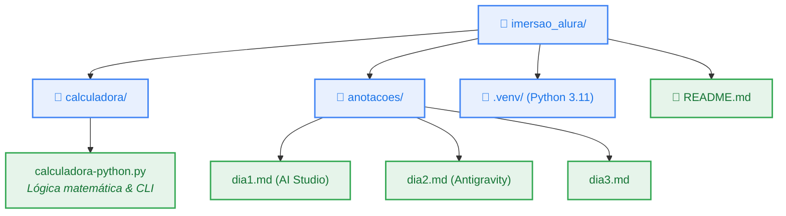
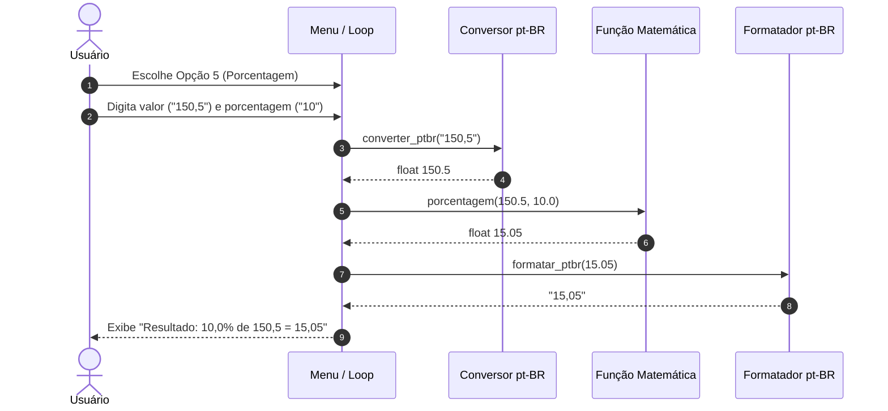

# 🛸 Dia 2 — Evoluindo a aplicação com o Google Antigravity

<div align="left">


</div>

---

## 📋 Enunciado do Desafio

Usar o **Google Antigravity** para importar o projeto da calculadora e modificar a aplicação existente em três etapas:

1. **Explorar o projeto:** identificar os arquivos e explicar como o código está organizado.
2. **Adicionar uma funcionalidade:** implementar o cálculo de porcentagem e suporte a números no padrão brasileiro (`pt-BR`).
3. **Testar a aplicação:** validar as novas regras sem comprometer o funcionamento das quatro operações básicas.

---

## 🏗️ 1. Estrutura do projeto (análise no Antigravity)

O projeto é modular e está dividido entre código executável, ambiente virtual e diário de aprendizado:



### Arquitetura interna do script `calculadora-python.py`:
* **Camada de Formatação / I18n (`pt-BR`):** Converte strings numéricas com vírgula para `float` e formata a saída com vírgula.
* **Operações Puras:** Funções atômicas com tipagem estática (*Type Hints*): `somar`, `subtrair`, `multiplicar`, `dividir` e `porcentagem`.
* **Interface CLI / Controle de Fluxo:** Laço `while True` com menu interativo e `match-case` moderno do Python.

---

## ⚡ 2. Nova funcionalidade: Porcentagem e Padrão pt-BR

### Fluxo de Dados com Localização pt-BR



### O que mudou no código:

```diff
+# 1. Funções de localização para pt-BR
+def converter_ptbr(texto: str) -> float:
+    """Permite vírgula decimal (ex: 10,5) e separador de milhar (ex: 1.000,50)."""
+    texto_limpo = texto.strip()
+    if "." in texto_limpo and "," in texto_limpo:
+        texto_limpo = texto_limpo.replace(".", "").replace(",", ".")
+    else:
+        texto_limpo = texto_limpo.replace(",", ".")
+    return float(texto_limpo)
+
+def formatar_ptbr(valor: float) -> str:
+    """Garante exibição com vírgula para o usuário brasileiro."""
+    if valor.is_integer():
+        return f"{valor:.1f}".replace(".", ",")
+    return f"{valor:.4f}".rstrip("0").replace(".", ",")

+# 2. Operação matemática de porcentagem
+def porcentagem(valor: float, taxa: float) -> float:
+    """Calcula taxa percentual sobre o valor base."""
+    return (valor * taxa) / 100

 # 3. Atualização do Menu e Match-case
     print("4. Divisão (/)")
+    print("5. Porcentagem (%)")
-    print("5. Sair")
+    print("6. Sair")
```

---

## 🧪 3. Bateria de Testes

> [!NOTE]
> Os testes foram executados com o interpretador Python 3.11 isolado no ambiente virtual (`.venv`), cobrindo testes unitários das funções e uma bateria completa de **testes funcionais ponta a ponta (E2E)** via `subprocess`.

### 3.1 Tabela de Casos de Teste Funcionais (E2E)

| # | Cenário Testado | Entrada Simulada | Saída Esperada | Saída Obtida | Status |
|:---:|:---|:---:|:---|:---|:---:|
| **1** | Opção inválida no menu | `9` | Retornar mensagem de opção inválida | `Opção inválida! Tente novamente.` | ✅ Aprovado |
| **2** | Entrada com caractere não numérico | `texto_invalido` | Bloquear entrada e pedir número válido | `Erro: Entrada inválida. Por favor, digite números válidos.` | ✅ Aprovado |
| **3** | **Soma com decimais (`pt-BR`)** | `12,5` e `7,5` | `Resultado: 12,5 + 7,5 = 20,0` | `Resultado: 12,5 + 7,5 = 20,0` | ✅ Aprovado |
| **4** | **Subtração com decimais (`pt-BR`)** | `20,0` e `4,8` | `Resultado: 20,0 - 4,8 = 15,2` | `Resultado: 20,0 - 4,8 = 15,2` | ✅ Aprovado |
| **5** | **Multiplicação com decimais (`pt-BR`)** | `4,5` e `2` | `Resultado: 4,5 * 2,0 = 9,0` | `Resultado: 4,5 * 2,0 = 9,0` | ✅ Aprovado |
| **6** | **Divisão com inteiros** | `15` e `3` | `Resultado: 15,0 / 3,0 = 5,0` | `Resultado: 15,0 / 3,0 = 5,0` | ✅ Aprovado |
| **7** | **Divisão por Zero (Resiliência)** | `10` e `0` | Tratar erro sem quebrar o programa | `Erro: Não é possível dividir por zero.` | ✅ Aprovado |
| **8** | **Porcentagem inteira** | `200` e `15` | `Resultado: 15,0% de 200,0 = 30,0` | `Resultado: 15,0% de 200,0 = 30,0` | ✅ Aprovado |
| **9** | **Porcentagem com decimal (`pt-BR`)** | `150,5` e `10` | `Resultado: 10,0% de 150,5 = 15,05` | `Resultado: 10,0% de 150,5 = 15,05` | ✅ Aprovado |
| **10** | **Encerramento limpo** | `6` | Mensagem de despedida e `exit code 0` | `Encerrando a calculadora. Até mais!` | ✅ Aprovado |

---

### 3.2 Log Real da Execução Automatizada

<details>
<summary><b>▶️ Clique para expandir o log da execução funcional</b></summary>

```console
=== CÓDIGO DE RETORNO ===
0

=== SAÍDA DA EXECUÇÃO (Trechos Principais) ===
 -> Escolha uma opção (1-6): Opção inválida! Tente novamente.
 -> Escolha uma opção (1-6): Digite o primeiro número: Erro: Entrada inválida. Por favor, digite números válidos (ex: 10 ou 10,5).
 ->  Resultado: 12,5 + 7,5 = 20,0
 ->  Resultado: 20,0 - 4,8 = 15,2
 ->  Resultado: 4,5 * 2,0 = 9,0
 ->  Resultado: 15,0 / 3,0 = 5,0
 -> Erro: Não é possível dividir por zero.
 ->  Resultado: 15,0% de 200,0 = 30,0
 ->  Resultado: 10,0% de 150,5 = 15,05
 -> Escolha uma opção (1-6): Encerrando a calculadora. Até mais!
```

</details>

---

## 💡 O que aprendi

1. **Desenvolvimento Incremental sem Regressão:** Adicionar uma nova funcionalidade (porcentagem) respeitando as interfaces existentes evita quebrar as operações que já estavam funcionando.
2. **Localização e Experiência do Usuário (UX):** No Brasil, a vírgula é o separador decimal padrão. Implementar a conversão bidirecional (`converter_ptbr` e `formatar_ptbr`) torna a CLI natural para usuários brasileiros sem quebrar a tipagem interna em `float`.
3. **Pair Programming com Google Antigravity:** A exploração assistida do contexto do workspace permitiu identificar rapidamente o interpretador adequado (Python 3.11 para suporte nativo ao `match-case`) e rodar testes automatizados direto pelo terminal.

