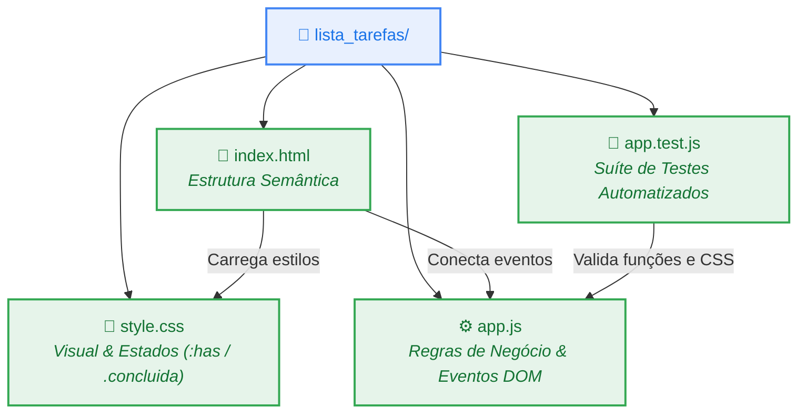
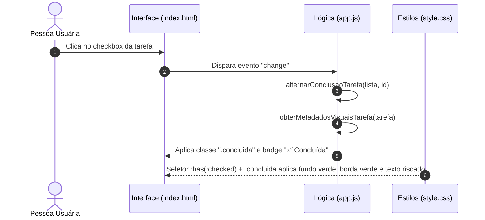

# 🛸 Dia 3 — Criando uma Lista de Tarefas com o Google Antigravity

<div align="left">


</div>

---

## 📋 Enunciado do Desafio

Desenvolver uma nova aplicação do zero usando o **Google Antigravity**: uma **Lista de Tarefas (To-Do List)** simples, com interface visual, que permita acompanhar atividades pendentes e concluídas.

A aplicação deve conter três funcionalidades essenciais:
1. **Adicionar tarefas:** digitar uma atividade e incluí-la na lista.
2. **Marcar tarefas como concluídas:** identificar as atividades já realizadas.
3. **Remover tarefas:** excluir atividades que não são mais necessárias.

Em seguida:
- Solicitar uma **melhoria visual** para que as tarefas concluídas apareçam visualmente diferentes das pendentes e compreender quais partes do código foram modificadas.
- Executar os **testes automatizados** para garantir que todas as funcionalidades operam corretamente.

---

## 💬 Prompts Utilizados

### 1. Criação da Aplicação Base
> *"Quero criar uma aplicação simples de lista de tarefas, com uma interface visual que permita adicionar, concluir e remover atividades. Estou começando a aprender desenvolvimento de software, então utilize tecnologias simples e organize o projeto de maneira que eu consiga compreender seus principais componentes."*

### 2. Solicitação de Melhoria Visual
> *"Quero que as tarefas concluídas apareçam visualmente diferentes das pendentes. Implemente essa melhoria e explique quais partes do código precisaram ser modificadas."*

---

## 🏗️ 1. Organização do Projeto e Principais Componentes

Para facilitar o aprendizado e manter responsabilidades bem separadas, a aplicação foi construída na pasta [`lista_tarefas/`](../lista_tarefas/) utilizando a tríade clássica da Web (**HTML + CSS + JavaScript puro**), sem dependência de frameworks complexos:



### Papel de cada arquivo:
* **[`index.html`](../lista_tarefas/index.html) (O Esqueleto / Estrutura):** Define os blocos visuais da página — cabeçalho, contadores de resumo (*Total*, *Pendentes* e *Concluídas*), formulário com campo de texto e botão `➕ Adicionar`, barra de filtros e a lista `<ul>` onde as tarefas são exibidas.
* **[`style.css`](../lista_tarefas/style.css) (O Visual / Estilo):** Define cores, espaçamentos, cartões e a aparência distinta entre tarefas pendentes e concluídas.
* **[`app.js`](../lista_tarefas/app.js) (O Cérebro / Comportamento):** Escuta os cliques da pessoa usuária, valida se o campo de texto não está vazio, adiciona/conclui/remove tarefas da lista, salva no navegador (`localStorage`) e atualiza a tela.

---

## 🎨 2. Melhoria Implementada: Diferenciação Visual (Pendentes vs. Concluídas)

### Fluxo de Atualização Visual ao Concluir uma Tarefa



### O que mudou e quais partes do código foram modificadas:

Para diferenciar visualmente as tarefas concluídas das pendentes, duas partes trabalharam em conjunto:

1. **No JavaScript ([`app.js`](../lista_tarefas/app.js)):** Criamos a função `obterMetadadosVisuaisTarefa(tarefa)`, que verifica a propriedade booleana `tarefa.concluida` (`true` ou `false`) e atribui:
   - A classe CSS `tarefa-item concluida` (ou `tarefa-item pendente`);
   - Um selo visual (*badge*) explícito: `✅ Concluída` (verde) ou `⏳ Pendente` (âmbar).
2. **No CSS ([`style.css`](../lista_tarefas/style.css)):** Utilizamos variáveis CSS no cartão `.tarefa-item` combinadas com o seletor moderno `:has(.tarefa-checkbox:checked)` e a classe `.concluida`:
   - **Pendente:** Fundo branco (`#ffffff`), borda lateral azul (`#4285f4`) e texto escuro normal.
   - **Concluída:** Fundo verde suave (`#f0fdf4`), borda lateral verde (`#34a853`), texto riscado (`text-decoration: line-through`) em cinza suave (`#64748b`) e leve redução de opacidade (`0.88`).

```diff
 /* Em lista_tarefas/style.css */
 .tarefa-item {
   --item-bg: #ffffff;
   --item-text: #1e293b;
   --item-borda-lateral: #4285f4;
   --item-decoracao: none;
 }

+/* Melhoria: altera variáveis visuais quando a tarefa está concluída */
+.tarefa-item:has(.tarefa-checkbox:checked),
+.tarefa-item.concluida {
+  --item-bg: #f0fdf4;
+  --item-text: #64748b;
+  --item-border: #bbf7d0;
+  --item-borda-lateral: #34a853;
+  --item-decoracao: line-through;
+  --item-opacidade: 0.88;
+}
```

```diff
 // Em lista_tarefas/app.js
+function obterMetadadosVisuaisTarefa(tarefa) {
+  const estaConcluida = Boolean(tarefa.concluida);
+  return {
+    classeItem: estaConcluida ? "tarefa-item concluida" : "tarefa-item pendente",
+    classeBadge: estaConcluida ? "status-badge concluida" : "status-badge pendente",
+    textoBadge: estaConcluida ? "✅ Concluída" : "⏳ Pendente",
+  };
+}
```

---

## 🧪 3. Bateria de Testes Automatizados

Os testes foram escritos em [`lista_tarefas/app.test.js`](../lista_tarefas/app.test.js) e executados com o test runner nativo do Node.js (`node --test`), validando as 3 funcionalidades principais, a proteção contra entradas vazias e a diferenciação visual.

### 3.1 Tabela de Casos de Teste

| # | Funcionalidade Testada | Cenário | Resultado Esperado | Status |
|:---:|:---|:---|:---|:---:|
| **1** | **Adicionar tarefa** | Inserir `"Estudar JavaScript no Antigravity"` | Cria objeto com `concluida: false` e texto limpo | ✅ Aprovado |
| **2** | **Validação de entrada** | Tentar adicionar string vazia `"   "` | Lança erro impedindo tarefa em branco | ✅ Aprovado |
| **3** | **Concluir tarefa** | Alternar status da tarefa (`id: 202`) | Muda `concluida` de `false` para `true` (e permite reabrir) | ✅ Aprovado |
| **4** | **Diferenciação visual** | Comparar metadados e CSS de pendente vs. concluída | Aplica classe `.concluida`, badge `✅ Concluída` e `line-through` | ✅ Aprovado |
| **5** | **Remover tarefa** | Excluir tarefa do meio da lista (`id: 2`) | Remove apenas o item alvo, preservando os demais | ✅ Aprovado |
| **6** | **Contadores e Filtros** | Filtrar lista mista (1 pendente e 2 concluídas) | Retorna contagens exatas `{ total: 3, pendentes: 1, concluidas: 2 }` | ✅ Aprovado |
| **7** | **Prevenção de colisão de ID** | Adicionar 10 tarefas simultâneas no mesmo milissegundo | Gera 10 IDs estritamente únicos e remove apenas 1 item | ✅ Aprovado |
| **8** | **Teste Funcional E2E (Chromium)** | Fluxo completo no navegador headless via Playwright | Estilos CSS computados, filtros, persistência e 0 erros de console | ✅ Aprovado |

### 3.2 Log Real da Execução

```console
$ node --test lista_tarefas/app.test.js
✔ 1. Adicionar tarefa: inclui nova atividade como pendente na lista (1.53323ms)
✔ 2. Validação de entrada: rejeita tarefa vazia ou apenas com espaços (0.51574ms)
✔ 3. Marcar tarefa como concluída: alterna o estado concluida (false -> true -> false) (0.225431ms)
✔ 4. Diferenciação visual: tarefas pendentes e concluídas recebem classes, badges e estilos distintos (0.47951ms)
✔ 5. Remover tarefa: exclui a atividade pelo ID sem afetar as demais (0.862836ms)
✔ 6. Resumo e Filtros: contabiliza e separa pendentes de concluídas corretamente (1.068228ms)
✔ 7. Prevenção de colisão de ID: adições simultâneas no mesmo milissegundo geram IDs únicos (0.394812ms)
ℹ tests 7
ℹ pass 7
ℹ fail 0
```

---

## 💡 O que aprendi

1. **Separação de Responsabilidades na Web:** Dividir o projeto em `index.html` (estrutura), `style.css` (estilo) e `app.js` (lógica) torna muito mais simples localizar onde fazer uma alteração — por exemplo, saber exatamente o que mudar no CSS e no JS quando queremos destacar tarefas concluídas.
2. **Estado vs. Interface Visual:** Toda alteração na tela nasce de uma mudança nos dados (a propriedade `concluida` mudando de `false` para `true`). Quando os dados estão bem organizados, atualizar contadores, filtros e cores torna-se previsível.
3. **CSS Moderno e Acessibilidade:** O uso de variáveis CSS combinadas com o seletor `:has(.tarefa-checkbox:checked)` e rótulos `<label>` amplos melhora tanto a experiência visual quanto a usabilidade por teclado ou clique.
4. **Validação Contínua com Testes:** Isolar funções puras (`adicionarTarefa`, `alternarConclusaoTarefa`, `removerTarefa`) permite rodar testes automatizados em milissegundos a cada melhoria implementada.
